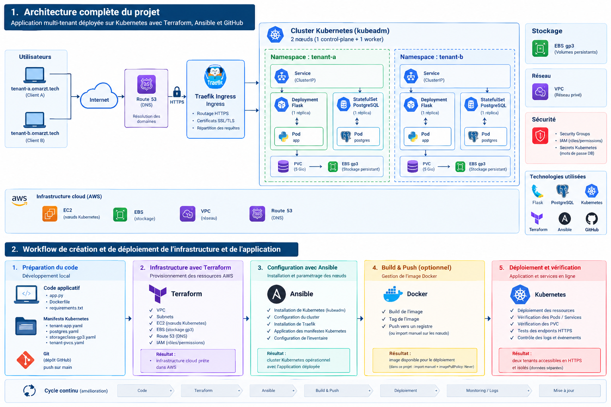

# Multi-Tenant Kubernetes Infrastructure on AWS

A hands-on Cloud & DevOps project demonstrating Infrastructure as Code,
configuration automation, self-managed Kubernetes, tenant separation,
HTTPS ingress, and persistent database storage on AWS.

> **Project status:** Personal learning project in progress. The README
> distinguishes implemented components from planned improvements. Review
> the repository manifests and scripts before treating any step as fully
> automated or production-ready.

## Table of contents

-   [Overview](#overview)
-   [Architecture](#architecture)
-   [Key features](#key-features)
-   [Technology stack](#technology-stack)
-   [AWS infrastructure](#aws-infrastructure)
-   [Kubernetes and tenant design](#kubernetes-and-tenant-design)
-   [Traffic flow](#traffic-flow)
-   [Database and persistent storage](#database-and-persistent-storage)
-   [Infrastructure automation](#infrastructure-automation)
-   [Repository structure](#repository-structure)
-   [Prerequisites](#prerequisites)
-   [Deployment workflow](#deployment-workflow)
-   [Validation and troubleshooting](#validation-and-troubleshooting)
-   [Security considerations](#security-considerations)
-   [Known limitations and roadmap](#known-limitations-and-roadmap)
-   [Cost and cleanup](#cost-and-cleanup)
-   [Learning outcomes](#learning-outcomes)

## Overview

The objective is to deploy two application environments on a
self-managed Kubernetes cluster running on AWS. Each tenant is organized
in its own Kubernetes namespace and has a separate application workload
and PostgreSQL database.

The project brings together:

-   **Terraform** to provision AWS infrastructure using reusable
    configuration.
-   **Ansible** to automate machine configuration and cluster setup
    tasks.
-   **Kubernetes (`kubeadm`)** to operate a self-managed cluster.
-   **Helm and Kubernetes manifests** to package and configure
    workloads.
-   **AWS Network Load Balancer (NLB) and Traefik** to expose and route
    application traffic.
-   **cert-manager** to manage TLS certificates.
-   **AWS EBS CSI, PersistentVolumes (PVs), and PersistentVolumeClaims
    (PVCs)** for database storage.
-   **NetworkPolicies** to restrict selected network paths between
    workloads.

This is a learning and portfolio project, not a production-ready
reference architecture.

## Architecture

The diagram below summarizes the intended application layout and the
provisioning/deployment workflow.



### Important architecture note

The supplied diagram shows the route from DNS/Internet to Traefik, but
does **not** explicitly draw the AWS Network Load Balancer. The deployed
environment also includes an NLB with target groups and health checks.
For the most accurate visual, update the diagram to show this path:

**Client → DNS (Route 53) → AWS Network Load Balancer → Kubernetes node
target/NodePort → Traefik → tenant Ingress → application Service →
application Pod.**

The exact NLB listener, target type, health-check protocol, and port
mappings should be confirmed from the current Terraform configuration
and AWS target-group settings before documenting them as definitive.

## Key features

-   Self-managed Kubernetes cluster bootstrapped with `kubeadm`.
-   Two tenant namespaces: `tenant-a` and `tenant-b`.
-   Separate application and PostgreSQL workloads for each tenant.
-   HTTPS access through Traefik Ingress and TLS certificates managed
    with cert-manager.
-   AWS EBS-backed persistent storage for PostgreSQL.
-   NetworkPolicies intended to restrict cross-tenant communication.
-   Modular Terraform configuration for AWS resources.
-   Ansible-based configuration automation.
-   Validation commands for nodes, workloads, storage, ingress, and
    policies.

## Technology stack

  -----------------------------------------------------------------------
  Component                           Role
  ----------------------------------- -----------------------------------
  AWS                                 Cloud infrastructure

  Terraform                           Infrastructure as Code for AWS
                                      resources

  Ansible                             Machine configuration and
                                      operational automation

  Amazon VPC                          Private cloud networking

  EC2                                 Kubernetes control-plane and worker
                                      nodes

  AWS Network Load Balancer           External entry point and traffic
                                      forwarding to configured targets

  Route 53                            DNS resolution for configured
                                      hostnames, where managed in this
                                      environment

  Kubernetes with `kubeadm`           Self-managed container
                                      orchestration

  containerd                          Container runtime

  Helm / Kubernetes manifests         Workload configuration and
                                      deployment

  Traefik                             Ingress routing

  cert-manager                        TLS certificate lifecycle
                                      management

  PostgreSQL                          Per-tenant relational database

  StatefulSets                        Management of stateful database
                                      workloads

  AWS EBS CSI                         Kubernetes integration with EBS
                                      block storage

  PV / PVC                            Kubernetes persistent storage
                                      abstractions

  NetworkPolicies                     Pod network traffic restrictions

  GitHub                              Source control and project
                                      documentation
  -----------------------------------------------------------------------

## AWS infrastructure

The AWS environment is deployed in **`eu-west-3` (Paris)**.

Terraform configuration is organized into modules for infrastructure
components such as:

-   VPC and subnet networking.
-   EC2 instances for Kubernetes nodes.
-   Security Groups.
-   Storage and related infrastructure where configured.
-   Network Load Balancer, listeners, target groups, and health checks
    where defined in the Terraform configuration.
-   IAM resources or permissions where included in the current
    configuration.
-   Route 53 records where managed by this repository.

Terraform should be used to review and manage the lifecycle of these
resources. Always inspect the plan before applying changes.

### Network Load Balancer

The NLB is part of the external traffic path. Its target groups direct
traffic to configured Kubernetes node targets; Traefik then applies
Kubernetes Ingress rules to select the tenant application.

The NLB does not perform tenant-level application routing. That
responsibility belongs to Traefik and the Kubernetes Ingress
configuration.

## Kubernetes and tenant design

The cluster currently uses a self-managed layout with one control-plane
node and one worker node. This is useful for learning cluster
administration, but it is **not a highly available cluster**.

### Tenant A

Namespace: `tenant-a`

-   Application workload and Service.
-   PostgreSQL StatefulSet and Service.
-   PVC/PV-backed database storage.
-   Namespace-specific NetworkPolicies.

### Tenant B

Namespace: `tenant-b`

-   Application workload and Service.
-   PostgreSQL StatefulSet and Service.
-   PVC/PV-backed database storage.
-   Namespace-specific NetworkPolicies.

### Isolation model

Namespaces provide logical organization, while NetworkPolicies restrict
selected network paths. Each tenant has its own database workload and
storage claim.

An application-level test has been performed in which data inserted
through Tenant A was not visible through Tenant B. This is a useful
functional check, but it does not prove complete security isolation.
Isolation also depends on policy correctness, RBAC, node and
control-plane access, secret handling, and other cluster settings.

## Traffic flow

The intended request path is:

1.  A client requests a tenant hostname.
2.  DNS resolves the hostname to the configured public entry point.
3.  The AWS Network Load Balancer forwards traffic to its configured
    Kubernetes node targets.
4.  Traffic reaches Traefik through the configured listener/target port
    path.
5.  Traefik uses the matching Ingress rule and TLS configuration.
6.  The tenant's application Service forwards the request to its
    application Pod.
7.  The application connects to its own PostgreSQL Service.

Configured tenant hostnames include:

-   `tenant-a.omarzt.tech`
-   `tenant-b.omarzt.tech`

These names require the corresponding DNS records and certificate
configuration to remain valid. Replace them when reproducing the project
in another environment.

## Database and persistent storage

Each tenant has a separate PostgreSQL StatefulSet and storage claim. The
storage relationship is:

**PostgreSQL Pod → PVC → PV → AWS EBS volume**

-   **StatefulSet:** manages the database workload.
-   **PVC:** requests storage for the workload.
-   **PV:** represents the provisioned storage resource in Kubernetes.
-   **AWS EBS:** provides the underlying block storage through the EBS
    CSI driver.

Persistent volumes protect data from ordinary container replacement when
correctly configured, but they are not a backup strategy. Database
backup and restoration must be implemented and tested separately.

Do not delete PVCs or PVs without checking their reclaim policy and
understanding the potential data-loss consequences.

## Infrastructure automation

### Terraform

Terraform describes and provisions AWS infrastructure as code. The
repository uses a modular structure for resources such as networking,
compute, and security groups. The exact list of managed resources should
be confirmed against the current Terraform modules.

Typical review commands, executed from the appropriate Terraform root
directory:

``` bash
terraform fmt -check
terraform validate
terraform plan
```

Run `terraform init` first when initializing a working copy or when the
provider/module configuration changes. Do not run `terraform apply`
until the plan has been reviewed.

### Ansible

Ansible is used for configuration and administration tasks on the
provisioned machines. It complements Terraform:

-   Terraform manages infrastructure resources.
-   Ansible configures machines and automates operational setup tasks.

The actual automation coverage depends on the playbooks and inventory
present in the repository. Document manual steps explicitly rather than
implying they are already automated.

### Image build and deployment

The current workflow includes an application image build/deployment
step, but image build and push should be described as **optional or not
yet fully automated** unless the current GitHub Actions workflow proves
otherwise. In the current lab, the image has also been imported manually
to the cluster nodes, with `imagePullPolicy: Never` used for the
relevant workload.

This means the repository should not be described as having a fully
automated end-to-end CI/CD pipeline until image publishing and
deployment have been tested from GitHub Actions through to the running
cluster.

## Repository structure

The repository has been organized around Terraform, Ansible, Helm
charts, Kubernetes resources, scripts, and GitHub workflows. Confirm the
exact paths in your working tree before publishing this outline.

``` text
.
├── terraform/
│   └── modules/
│       ├── vpc/
│       ├── ec2/
│       └── security-groups/
├── ansible/
├── helm/
│   └── tenant-app/
├── k8s/
│   ├── cert-manager/
│   ├── monitoring/
│   └── traefik/
├── scripts/
├── .github/
│   └── workflows/
│       └── ci-cd.yml
├── docs/
│   └── architecture.png
└── README.md
```

Adjust the tree to match the files that are actually committed. Do not
include empty folders or files that are not present.

## Prerequisites

Depending on the workflow being run, you may need:

-   An AWS account and appropriate IAM permissions.
-   AWS CLI configured with the intended profile and region.
-   Terraform.
-   Ansible and SSH access to the Linux instances.
-   `kubectl` and access to the Kubernetes cluster.
-   Helm.
-   A DNS domain if reproducing the public HTTPS setup.

The project was developed from a Windows workstation using PowerShell,
with the AWS CLI configured for `eu-west-3`. Adjust paths and shell
syntax for your environment.

## Deployment workflow

The high-level workflow is:

1.  Review Terraform variables and module configuration.
2.  Initialize Terraform in the correct root directory.
3.  Run formatting and validation checks.
4.  Review `terraform plan`.
5.  Provision or update AWS infrastructure.
6.  Configure the machines using the available Ansible inventory and
    playbooks.
7.  Bootstrap and validate the Kubernetes cluster.
8.  Install or validate the cluster networking and Traefik components.
9.  Configure cert-manager and TLS resources.
10. Deploy tenant application and PostgreSQL resources.
11. Confirm PVC/PV binding and EBS provisioning.
12. Apply and validate NetworkPolicies.
13. Test tenant routing, HTTPS, and application-level data separation.

The exact commands depend on the current Terraform root module, Ansible
playbooks, Helm chart values, and Kubernetes manifests. Use the
repository's actual configuration rather than assuming every step is
automated.

## Validation and troubleshooting

Run these commands against the intended cluster context.

### Cluster nodes

``` bash
kubectl get nodes -o wide
```

### Tenant workloads

``` bash
kubectl get pods,svc -n tenant-a
kubectl get pods,svc -n tenant-b
```

### Storage

``` bash
kubectl get pvc -n tenant-a
kubectl get pvc -n tenant-b
kubectl get pv
kubectl get storageclass
```

### Ingress and certificates

``` bash
kubectl get ingress -A
kubectl get pods -n traefik
kubectl get certificates -A
```

If cert-manager resources use a different namespace, adjust the commands
accordingly.

### NetworkPolicies

``` bash
kubectl get networkpolicy -n tenant-a
kubectl get networkpolicy -n tenant-b
```

These commands inspect resource state; they do not alone prove complete
connectivity, security, persistence, or recovery. Test expected and
denied traffic paths explicitly.

## Security considerations

This is a lab environment. Before considering a production use case,
review at least:

-   Least-privilege IAM and Kubernetes RBAC.
-   Security Group rules and public exposure.
-   NetworkPolicy enforcement by the installed CNI.
-   Secret storage and rotation.
-   TLS certificate renewal and DNS configuration.
-   Database authentication, backups, and restoration.
-   Node hardening, patching, audit logs, and monitoring.
-   High availability and disaster recovery.

Do not publish private keys, passwords, kubeconfig files, state files
containing secrets, account identifiers, or other sensitive
configuration in the repository.

## Known limitations and roadmap

This project is evolving. The following are improvement areas to
validate or complete:

-   [ ] Verify that infrastructure provisioning and node configuration
    are reproducible from a clean environment.
-   [ ] Complete and test end-to-end CI/CD, including image build, image
    publication, and deployment.
-   [ ] Test database persistence after pod recreation.
-   [ ] Implement and test database backup and restoration.
-   [ ] Improve monitoring and alerting.
-   [ ] Test both allowed and denied network flows between tenants.
-   [ ] Review RBAC, secrets handling, and cluster hardening.
-   [ ] Document recovery procedures and failure scenarios.
-   [ ] Improve cost controls and safe cleanup documentation.

Mark items complete only after the corresponding test has been run
successfully.

## Cost and cleanup

AWS resources may incur charges, including EC2 instances, Network Load
Balancers, EBS volumes, public IPv4 addresses, and networking services.
Free-tier eligibility varies by resource, account, and current AWS
terms.

Before running Terraform commands:

-   Confirm the AWS profile and region.
-   Review the complete plan.
-   Check which resources will be created, modified, or destroyed.
-   Stop or remove unused resources safely.
-   Preserve any data that must be retained.

Avoid running `terraform destroy` or deleting PVCs until you have
reviewed the impact. Deleting infrastructure or storage may permanently
remove database data.

## Learning outcomes

This project provides hands-on experience with:

-   AWS infrastructure and Infrastructure as Code.
-   Terraform modules and infrastructure lifecycle management.
-   Ansible-based configuration automation.
-   Self-managed Kubernetes using `kubeadm`.
-   Tenant-oriented workload organization and network restrictions.
-   Stateful applications and persistent storage.
-   AWS Network Load Balancer and Traefik ingress routing.
-   TLS certificate management.
-   Troubleshooting, validation, and iterative automation.

## Author

Cloud & DevOps engineering student focused on AWS, Kubernetes,
Infrastructure as Code, automation, and cloud security.
